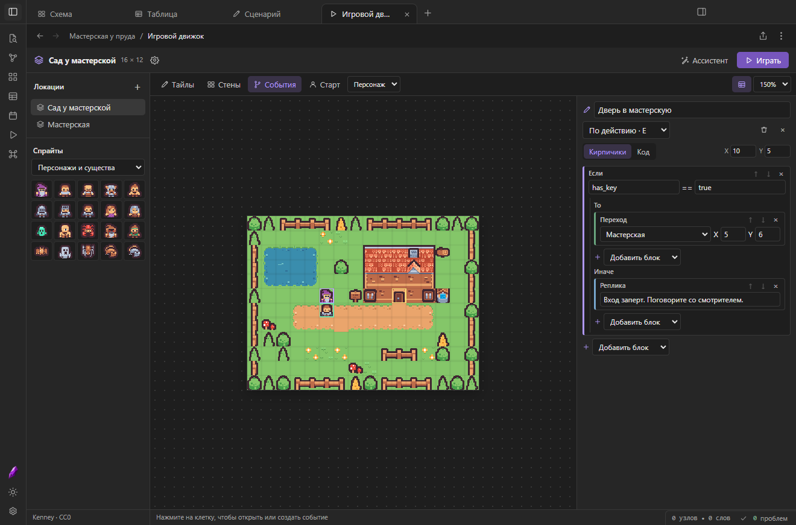
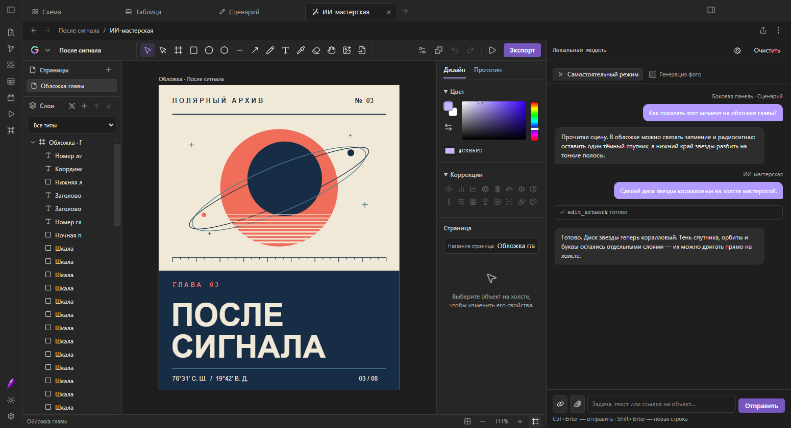
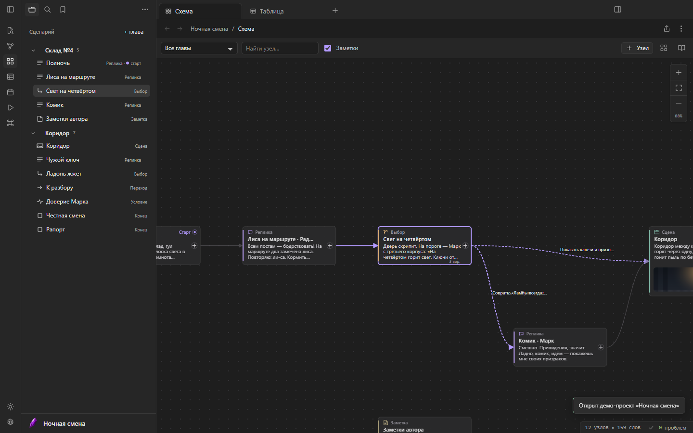
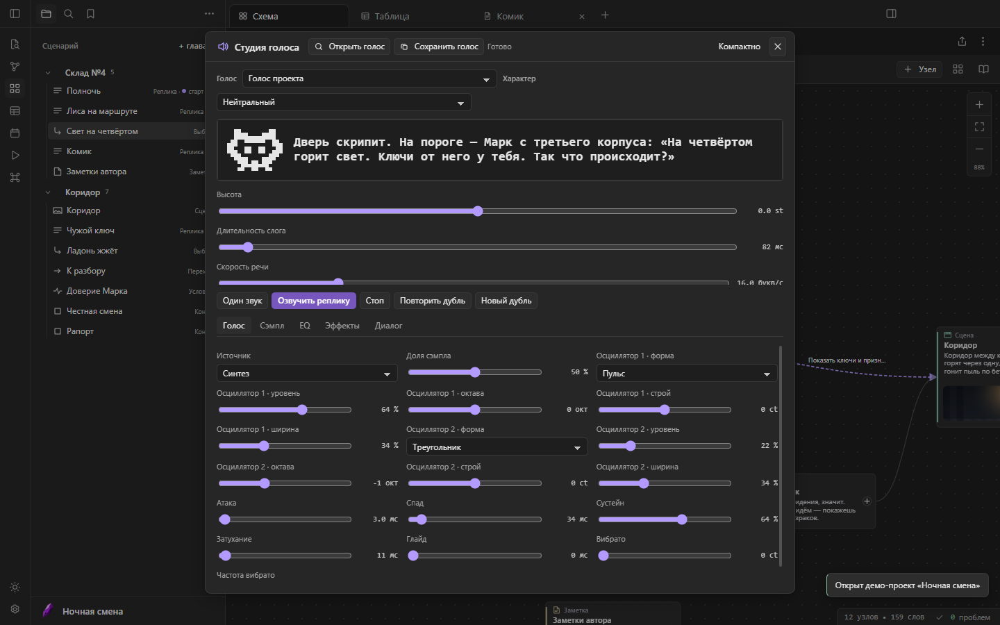

# 

**StoryForge** is a desktop editor for branching dialogue. Write a scene, connect the player’s choices, play through a branch, then export the dialogue to Godot or Ren’Py. The script, graph, Gigma designs and character voices travel together in a local `.sfproj` file.

[](https://github.com/sunakle/Story-Studio/releases/latest/download/StoryForge-Setup-x64.exe)

[All releases](https://github.com/sunakle/Story-Studio/releases) · [User guide (Russian)](docs/guide.ru.md) · [Gallery](#gallery) · [Русский](README.md)

## Your first scene

1. Run the installer and choose whether to add a desktop shortcut. Open **StoryForge** from the Start menu or the shortcut.
2. Choose **+ → Open screenplay**. Write where the scene takes place and what the characters say. To open an existing project, press **Ctrl+O**.
3. Choose **+ → Create line** to add your first line of dialogue. Connect it to the player’s choices in the flow editor, then start a playthrough from the selected node. **Ctrl+S** saves the whole project.

StoryForge saves your work on this computer when you close the app and reopens your last project on launch. Change this under **Settings → Saving → Continue with the last project**. Choose **Open projects folder** there to find your locally created `.sfproj` files.

<details>
<summary>Windows setup and interface language</summary>

The installer includes the runtime. If the editor opens in Russian, go to **Настройки → Оформление** and select **English**. You can switch back under **Settings → Appearance**.


</details>

## Game engine

Open **+ → Game engine**. Paint the map with tiles, mark walls, set the player spawn, then add characters or doors under **Events**. Use **+** in the map list for another room. Each event has visual blocks and editable source for the same dialogue, variables, branches and transfers.

Choose **Play** to try the map. Use the arrow keys or **WASD** to move and **Space** to talk or advance dialogue. In a new game, try **Door example** to pick up a key from the garden caretaker and enter the workshop. Maps and events live in the same `.sfproj` as the screenplay and work offline. **Assistant** lets your connected model read and edit the selected map and event.

The bundled pixel art includes Kenney’s complete **Tiny Town** and **Tiny Dungeon** packs under CC0, plus water variants. [Tiny Town](https://kenney.nl/assets/tiny-town) · [Tiny Dungeon](https://kenney.nl/assets/tiny-dungeon) · [CC0 license](https://creativecommons.org/publicdomain/zero/1.0/)



## Design in Gigma Studio

Choose **+ → Open Gigma Studio** to go straight to the canvas for your current StoryForge project. Add another game screen with **+** in the **Pages** panel. Press **F** for a frame, **R** for a rectangle or **T** for text.

<picture>
  <source media="(prefers-color-scheme: light)" srcset="docs/gallery/gigma-workspace-light.png">
  
</picture>

Press **Ctrl+S** on the canvas to save the script, graph, pages, images and prototype links in one `.sfproj` file. Choose **+ → Open Gigma Studio** again to return to the same canvas. Importing a `.gigma` file adds its pages to the current project. Designs from earlier versions remain accessible by name. [Dark theme](docs/gallery/gigma-workspace.png) · [Light theme](docs/gallery/gigma-workspace-light.png)

## AI studio

Choose **+ → Open AI studio** to edit a project canvas alongside the chat. For example, copy a link to a text layer in Gigma and ask the assistant to move the title to the studio canvas and give it a fade-in animation. You can then edit the text and position by hand.

Drop a photo into the chat. Next to its thumbnail, choose **To canvas… → Insert with bounce** to add an animated layer offline. You can also ask the model to place it. Select **Send only the filenames to the model** to let it use the attachment by reference while keeping its pixels on your computer. Unsent photos and text are retained when closing the app normally.

The studio and sidebar share one conversation per project. Each turn records the project, the surface that sent it, the open view and the available selection. Ask about a selected line in the sidebar, then continue designing in the studio. One undo reverses the edits from a turn.

**Autonomous mode** continues work on the canvas between your messages and uses provider tokens while active. Stop it from the studio. For generated images, open **Connection settings → Image generation** and enter an Images API base URL, model and key. The chat model can use that service to place images in the project.

Enable image generation in the studio controls to allow it during autonomous work. Autonomous mode must be started again after switching projects or restarting the app.



## Write, voice and play a branch

| Workspace | What you can do |
| --- | --- |
| Screenplay and AI chat | Write in plain text, then select **Create nodes…** to prepare a request in chat. Send it to turn the scene into dialogue nodes and choices. A single **Ctrl+Z** undoes the edits from that request. |
| Story table and graph overview | Filter a character’s dialogue with a query such as `type:line speaker:Anna`. Hover over a node in the overview to see its direct connections. |
| Voice Studio | Give a character or an individual line a voice, preview it and save it with the project. Add a voice to the local library to use it in another story. |
| Playback and export | Try a choice, inspect story variables and step back to explore another branch. Export to Godot 4, Ren’Py, Markdown or JSON. |

<details>
<summary>Model setup, image attachments and dictation</summary>

Select DeepSeek, Anthropic (Claude) or another compatible provider in AI settings and enter its API URL, key and model ID. A single DeepSeek model is selected by default. In **Agent mode**, coauthors draft in parallel and the primary model combines their edits. You can paste, drop or attach photos when the selected model supports images. Three built-in writing skills cover dialogue, scene sequencing and revision. [Writing skill sources](https://github.com/jwynia/agent-skills)

With a configured Yandex Station Lite 2 and the Windows command bridge, say **«Алиса, открой StoryForge»** to dictate into the screenplay. Stop with the speaker’s top button, the stop button in the editor or **«Стоп, диктовка»**. [Alice integration (Russian)](integrations/alice/README.md)

</details>

## Gallery

| Dialogue graph | Screenplay and AI chat |
| --- | --- |
| [](docs/gallery/flow.png) | [](docs/gallery/screenplay.png) |
| **Playthrough** | **Voice Studio** |
| [](docs/gallery/playback.png) | [](docs/gallery/voice.png) |

[Scene editor](docs/gallery/scene.png) · [Story table](docs/gallery/table.png) · [Graph in motion](docs/ui-obsidian/graph-interaction.gif) · [English settings](docs/gallery/english.png) · [Save on exit](docs/ui-obsidian/09-close.png)

## Run from source

For development on Windows, install Git and Node.js 22 or later with npm.

```powershell
git clone https://github.com/sunakle/Story-Studio.git
cd Story-Studio
npm.cmd ci
npm.cmd start
```

`npm.cmd test` checks the project model, persistence, playback and exports. Run `npm.cmd run selftest` for the Electron UI suite. To build the installer, install Inno Setup 6.7 or later and run `npm.cmd run dist:win`.

[Project format](CONTRACT.md) · [Gigma integration](integrations/gigma/README.md) · [Test tools](tools/README.md) · [MIT license](LICENSE)
