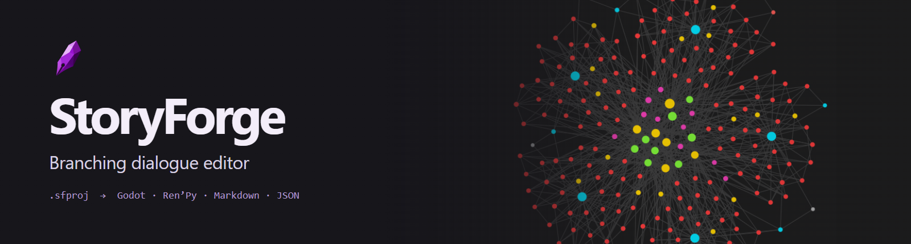
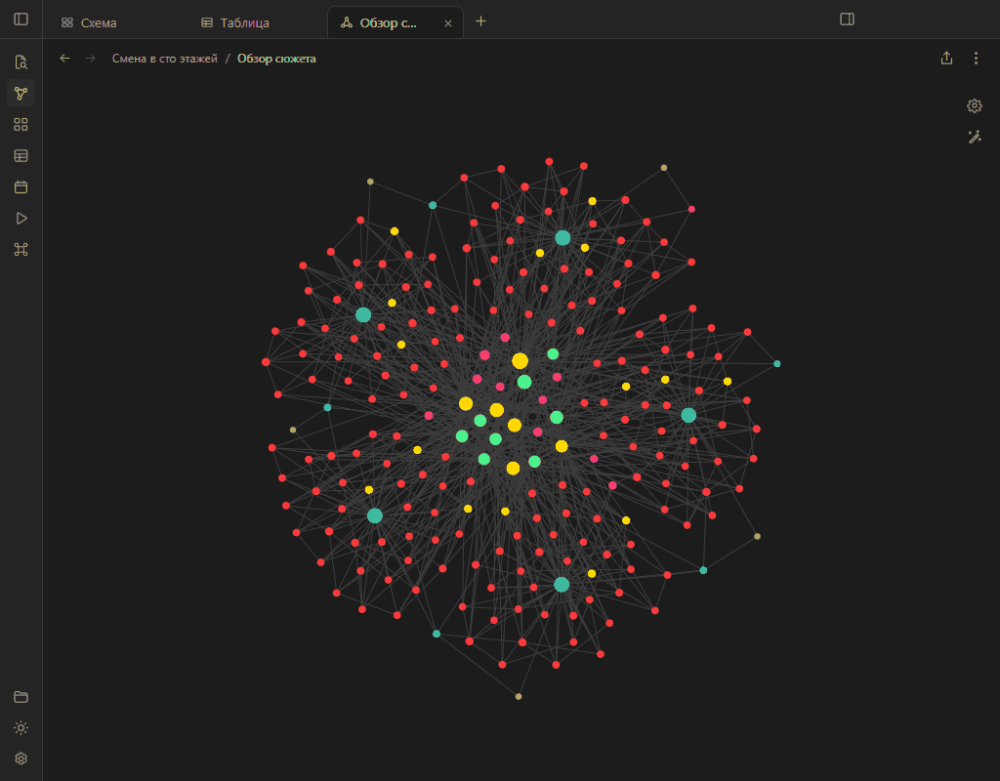

**A desktop editor for branching dialogue and game scripts.** Write a scene, connect its choices, and play a branch with live story variables. Your script, embedded images and character voice settings live in a local `.sfproj` file.

[**Download for Windows x64**](https://github.com/sunakle/Story-Studio/releases/download/v1.1.0/StoryForge-Setup-1.1.0-x64.exe) · [Русский](README.md) · [Releases](https://github.com/sunakle/Story-Studio/releases)

[Story flow](docs/gallery/flow.png)

## Start writing

1. Run the Windows installer and open **StoryForge** from the desktop. The installer includes the application runtime.
2. Open **Настройки → Оформление** and select **English**. The choice persists across launches and applies to interface labels. Story text and character names stay in their original language.
3. Start a new story or press **Ctrl+O** to open your own `.sfproj`. Add a scene and a line, then start a playthrough from that scene.

## Save a voice

Select a line and open Voice Studio. Choose the character to set a voice for their lines, or choose **Selected line** to give it its own voice. Adjust the sound or import a WAV, then save with **Ctrl+S**. The `.sfproj` carries the settings and sample to another computer. Add a voice to the local library to reuse it in other stories on this computer.

## Inside the editor

| Workspace | What you can do |
| --- | --- |
| Scene editor and graph | Write dialogue, assign a speaker, and connect choices, conditions and jumps. |
| Story table | Search scenes, filter by speaker or location, and save named views. |
| Playback | Try decisions, inspect variables, and undo a step. |
| Graph overview | Explore how scenes, characters and chapters connect. Hover to focus on a neighborhood or drag a node to change the layout. |
| Voice Studio | Design a character voice, preview a line, shape a sample and render WAV files. |
| Export | Write Godot 4, Ren’Py, Markdown or JSON output. The optional AI assistant connects to an OpenAI-compatible service you configure. |

| English preferences | Voice Studio |
| --- | --- |
| [](docs/gallery/english.png) | [](docs/gallery/voice.png) |

[Scene editor](docs/gallery/scene.png) · [Story table](docs/gallery/table.png) · [Playback](docs/gallery/playback.png) · [Save on exit](docs/ui-obsidian/09-close.png)



## Run from source

Install Git and Node.js 22 or later with npm.

```powershell
git clone https://github.com/sunakle/Story-Studio.git
cd Story-Studio
npm.cmd ci
npm.cmd start
```

Run `npm.cmd test` for the model, persistence, playback and export checks. Run `npm.cmd run selftest` for the Electron UI suite. To build the Windows installer, install Inno Setup 6.3 or later and run `npm.cmd run dist:win` on Windows.

[Project format](CONTRACT.md) · [MIT License](LICENSE)

