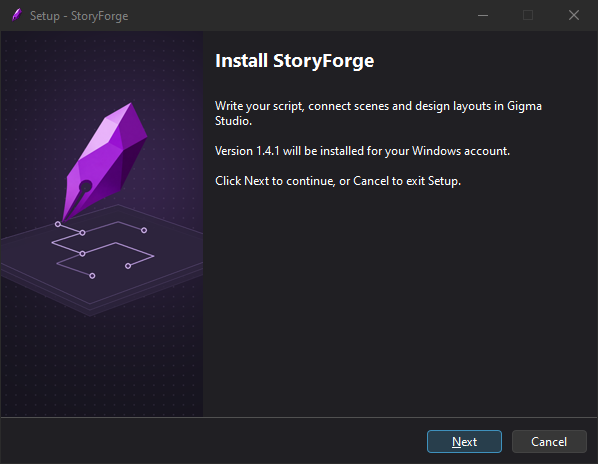
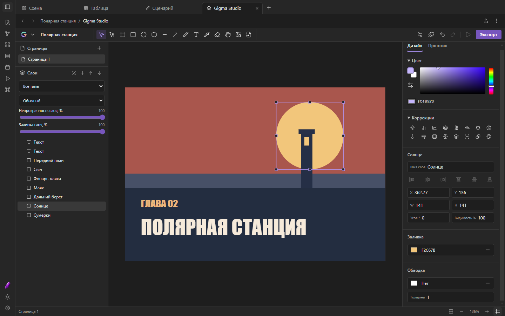
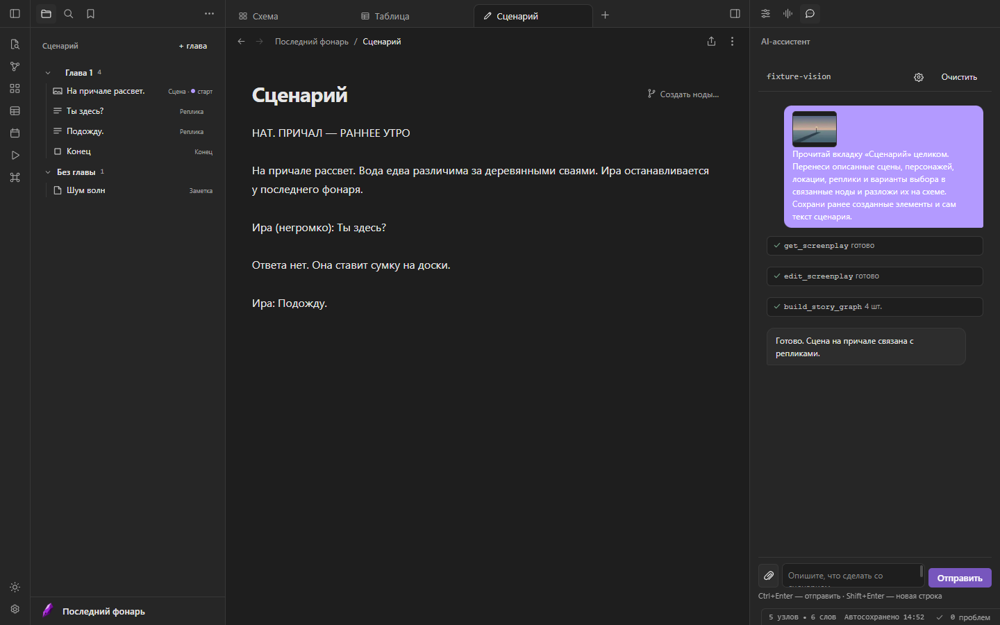
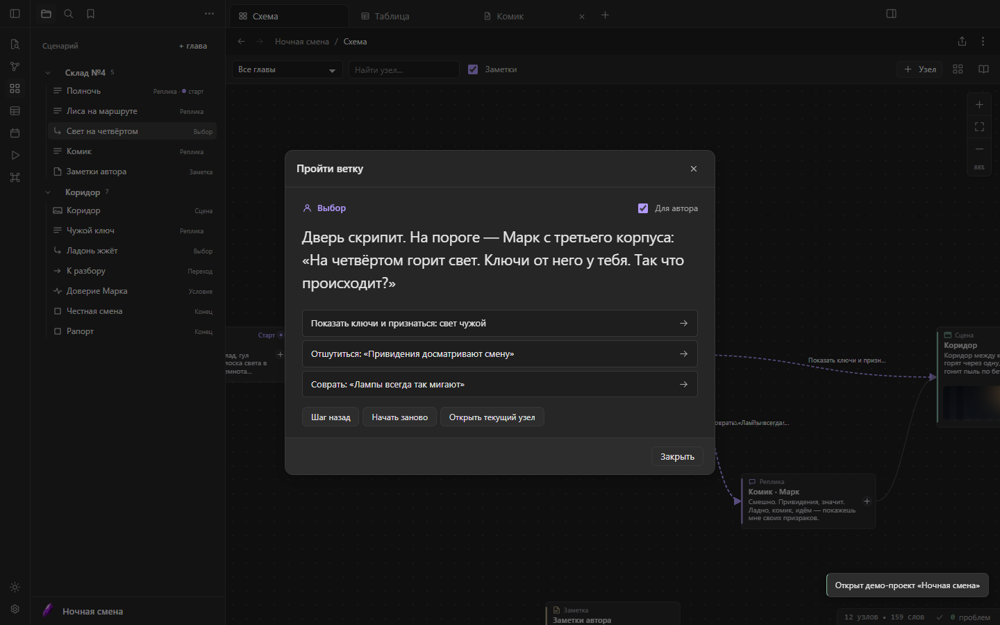

# 

**StoryForge** is a desktop editor for branching dialogue. Write a scene, connect the player’s choices, play through a branch, then export the dialogue to Godot or Ren’Py. The script, graph, Gigma designs and character voices travel together in a local `.sfproj` file.

[](https://github.com/sunakle/Story-Studio/releases/latest/download/StoryForge-Setup-x64.exe)

[All releases](https://github.com/sunakle/Story-Studio/releases) · [User guide (Russian)](docs/guide.ru.md) · [Gallery](#gallery) · [Русский](README.md)

## Your first scene

1. Run the installer and choose whether to add a desktop shortcut. Open **StoryForge** from the Start menu or the shortcut.
2. Choose **+ → Open screenplay**. Write where the scene takes place and what the characters say. To open an existing project, press **Ctrl+O**.
3. Choose **+ → Create line** to add your first line of dialogue. Connect it to the player’s choices in the flow editor, then start a playthrough from the selected node. **Ctrl+S** saves the whole project.

<details>
<summary>Windows setup and interface language</summary>

The installer includes the runtime. If the editor opens in Russian, go to **Настройки → Оформление** and select **English**. You can switch back under **Settings → Appearance**.



</details>

## Design in Gigma Studio

Choose **+ → Open Gigma Studio** to go straight to the canvas for your current StoryForge project. Add another game screen with **+** in the **Pages** panel. Press **F** for a frame, **R** for a rectangle or **T** for text.

<picture>
  <source media="(prefers-color-scheme: light)" srcset="docs/gallery/gigma-workspace-light.png">
  
</picture>

Press **Ctrl+S** on the canvas to save the script, graph, pages, images and prototype links in one `.sfproj` file. Choose **+ → Open Gigma Studio** again to return to the same canvas. Importing a `.gigma` file adds its pages to the current project. Designs from earlier versions remain accessible by name. [Dark theme](docs/gallery/gigma-workspace.png) · [Light theme](docs/gallery/gigma-workspace-light.png)

## Write, voice and play a branch

| Workspace | What you can do |
| --- | --- |
| Screenplay and AI chat | Write in plain text, then select **Create nodes…** to prepare a request in chat. Send it to turn the scene into dialogue nodes and choices. A single **Ctrl+Z** undoes the edits from that request. |
| Story table and graph overview | Filter a character’s dialogue with a query such as `type:line speaker:Anna`. Hover over a node in the overview to see its direct connections. |
| Voice Studio | Give a character or an individual line a voice, preview it and save it with the project. Add a voice to the local library to use it in another story. |
| Playback and export | Try a choice, inspect story variables and step back to explore another branch. Export to Godot 4, Ren’Py, Markdown or JSON. |

<details>
<summary>Model setup, image attachments and dictation</summary>

Enter your OpenAI-compatible service URL, key and model ID in AI settings. A single DeepSeek model is selected by default. In **Agent mode**, coauthors draft in parallel and the primary model combines their edits. You can paste, drop or attach photos when the selected model supports images. Three built-in writing skills cover dialogue, scene sequencing and revision. [Writing skill sources](https://github.com/jwynia/agent-skills)

With a configured Yandex Station Lite 2 and the Windows command bridge, say **«Алиса, открой StoryForge»** to dictate into the screenplay. Stop with the speaker’s top button, the stop button in the editor or **«Стоп, диктовка»**. [Alice integration (Russian)](integrations/alice/README.md)

</details>

## Gallery

| Dialogue graph | Screenplay and AI chat |
| --- | --- |
| [](docs/gallery/flow.png) | [](docs/gallery/screenplay.png) |
| **Playthrough** | **Voice Studio** |
| [](docs/gallery/playback.png) | [](docs/gallery/voice.png) |

[Scene editor](docs/gallery/scene.png) · [Story table](docs/gallery/table.png) · [Graph in motion](docs/ui-obsidian/graph-interaction.gif) · [English settings](docs/gallery/english.png) · [Save on exit](docs/ui-obsidian/09-close.png)

## Run from source

For development on Windows, install Git and Node.js 22 or later with npm.

```powershell
git clone https://github.com/sunakle/Story-Studio.git
cd Story-Studio
npm.cmd ci
npm.cmd start
```

`npm.cmd test` checks the project model, persistence, playback and exports. Run `npm.cmd run selftest` for the Electron UI suite. To build the installer, install Inno Setup 6.7 or later and run `npm.cmd run dist:win`.

[Project format](CONTRACT.md) · [Gigma integration](integrations/gigma/README.md) · [Test tools](tools/README.md) · [MIT license](LICENSE)
