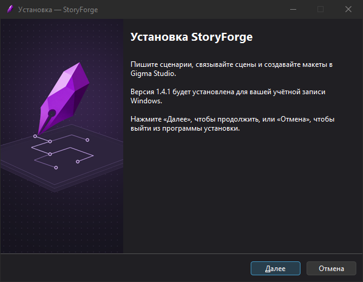
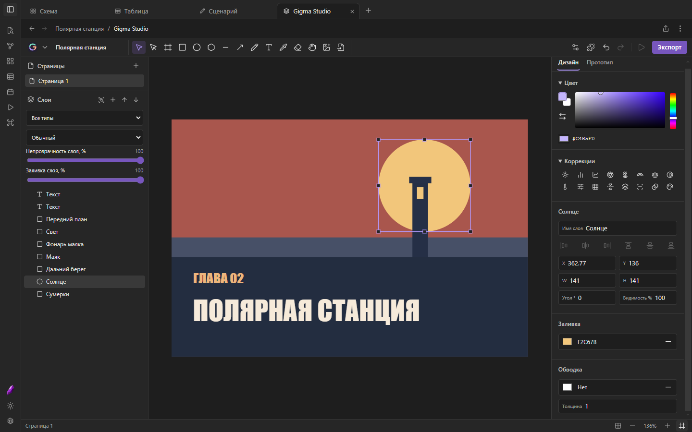
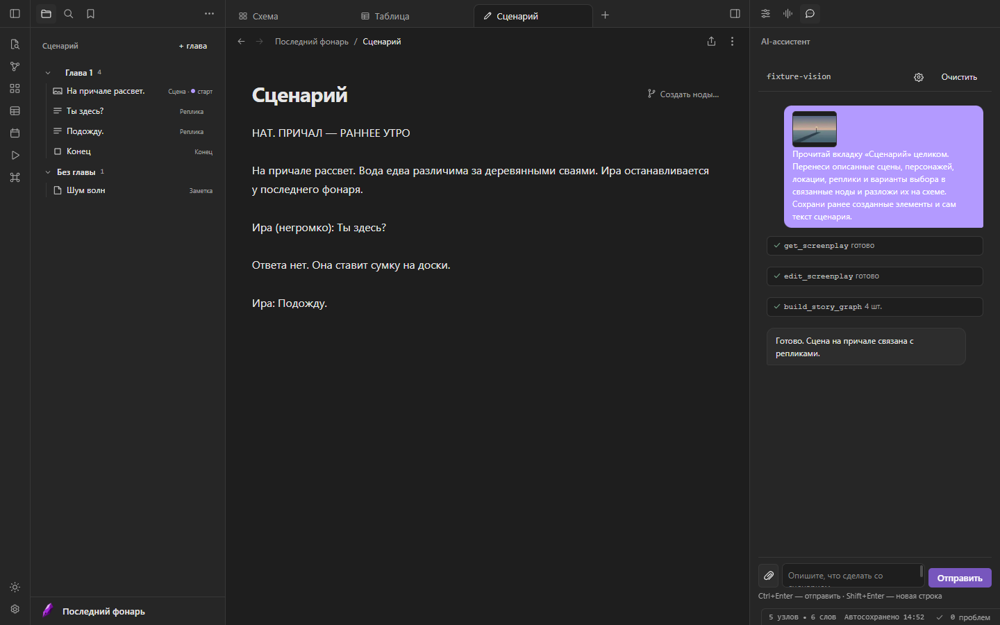

# 

**StoryForge** — настольный редактор ветвящихся диалогов. Напишите сцену, свяжите ответы игрока, пройдите получившуюся ветку и передайте диалог в Godot или Ren’Py. Текст, граф, макеты Gigma и голоса персонажей сохраняются вместе в локальном файле `.sfproj`.

[](https://github.com/sunakle/Story-Studio/releases/latest/download/StoryForge-Setup-x64.exe)

[Все выпуски](https://github.com/sunakle/Story-Studio/releases) · [Руководство](docs/guide.ru.md) · [Галерея](#галерея) · [English](README.en.md)

## Первая сцена

1. Запустите скачанный установщик. При желании добавьте ярлык на рабочий стол. Откройте **StoryForge** из меню «Пуск» или с ярлыка.
2. Нажмите **+ → Открыть сценарий** и запишите, где происходит сцена и что говорят персонажи. Чтобы открыть существующий проект, нажмите **Ctrl+O**.
3. Для первой реплики выберите **+ → Создать реплику**. На вкладке **Схема** свяжите её с вариантами ответа и запустите прохождение от выбранного узла. **Ctrl+S** сохраняет весь проект.

При закрытии StoryForge сохраняет работу на компьютере. При следующем запуске откроется последний проект. Этим управляет **Настройки → Сохранение → Продолжать с последнего проекта**. Там же кнопка **Открыть папку проектов** показывает созданные локальные файлы `.sfproj`.

<details>
<summary>Установщик и выбор языка</summary>

В комплект входит всё необходимое для запуска редактора. В **Настройки → Оформление** можно выбрать русский или английский язык интерфейса.



</details>

## Игровой движок

Откройте **+ → Игровой движок**. Выберите тайл и рисуйте по карте мышью. Инструмент **Стены** задаёт непроходимые клетки, **Старт** ставит игрока, а **События** размещает персонажей и двери. Для второй комнаты добавьте локацию кнопкой **+** в списке слева. Карты и события входят в обычный файл проекта `.sfproj`.

Холст занимает всю рабочую область. Зажмите **Пробел** и потяните мышью, чтобы сдвинуть вид в любую сторону, в том числе влево и вверх от начала карты. Колесо меняет масштаб вокруг курсора. Можно продолжать рисовать за краем старой локации. Для прохода между участками проложите дорожку тайлами. При повторном открытии редактор вспомнит выбранную карту, место и масштаб на этом компьютере.

У каждого события есть кирпичики и вкладка с исходным кодом. Соберите условие, реплику, изменение переменной или переход, затем нажмите **Играть**. Стрелки и **WASD** двигают героя, **Пробел** начинает разговор и листает реплики. В новой игре доступен **Пример с дверью**. Обратитесь к смотрителю в саду, затем откройте мастерскую.

Рисование и прохождение работают офлайн. Кнопка **Ассистент** открывает чат подключённой модели с текущей локацией и выбранным событием. В комплект входят полные наборы **Tiny Town** и **Tiny Dungeon** автора Kenney и дополнительные варианты воды. [Tiny Town](https://kenney.nl/assets/tiny-town) · [Tiny Dungeon](https://kenney.nl/assets/tiny-dungeon) · [Лицензия CC0](https://creativecommons.org/publicdomain/zero/1.0/)

Локальная палитра **Pixel 16 Woods v2 Free** от zedpxl меняет природные тайлы в редакторе и игре. Вместе с ней можно подключить **Super Retro World Character Pack** от Gif, Noiracide и Romi. Появятся 32 персонажа и ходьба в четырёх направлениях. Номера тайлов и роли героя и NPC в старых проектах сохраняются. Архитектура использует спрайты Kenney. [Лесной набор](https://zedpxl.itch.io/pixelart-forest-asset-pack) · [Набор персонажей](https://farm-animal.itch.io/character-pack)

Чтобы подключить свои копии архивов, выполните команды PowerShell из папки исходников с Python 3.10+ и Pillow, затем перезапустите установленный StoryForge. Для запуска через `npm start` укажите `.userdata\tilesets` в качестве каталога.

```powershell
$tiles = "$env:LOCALAPPDATA\StoryForge\User Data\tilesets"
python tools/make-woods-pack.py "$env:USERPROFILE\Downloads\pixel_16_woods v2 free.zip" "$tiles\woods-v2.png"
python tools/make-character-tiles.py "$env:USERPROFILE\Downloads\SuperRetroWorld_CharacterPack_Full.zip" "$tiles\woods-v2.png" "$tiles\woods-characters.png" "$tiles\retro-walk.png"
```


## Макеты Gigma Studio

Нажмите **+ → Открыть Gigma Studio**. Сразу откроется холст текущего проекта StoryForge. Для следующего экрана игры добавьте страницу кнопкой **+** в панели **Страницы**. На холсте нажмите **F** для кадра, **R** для прямоугольника или **T** для текста.

<picture>
  <source media="(prefers-color-scheme: light)" srcset="docs/gallery/gigma-workspace-light.png">
  
</picture>

**Ctrl+S** на холсте сохраняет сценарий, граф, страницы, изображения и переходы прототипа в одном файле `.sfproj`. Через **+ → Открыть Gigma Studio** можно вернуться к тому же холсту. Импорт `.gigma` добавляет страницы в открытый проект. Макеты из прежних версий доступны по своим именам. [Тёмная тема](docs/gallery/gigma-workspace.png) · [Светлая тема](docs/gallery/gigma-workspace-light.png)

## ИИ-мастерская

Откройте **+ → Открыть ИИ-мастерскую**. В ней рядом с чатом находится редактируемый холст проекта. Например, выделите текстовый слой Gigma, скопируйте ссылку на него и попросите в чате перенести заголовок на холст мастерской и добавить плавное появление. После ответа можно вручную поменять текст или положение слоя.

Перетащите фото в чат. Рядом с миниатюрой нажмите **На холст… → Вставить с отскоком**, чтобы добавить анимированный слой без сети. Можно также попросить об этом модель. Опция **Передать модели только имена файлов** оставляет пиксели на компьютере и позволяет модели разместить фотографию по имени. Неотправленные фотографии и текст сохраняются при штатном закрытии.

У мастерской и бокового чата общая история в пределах проекта. С каждым обращением модель получает название проекта, окно отправки, открытый раздел и доступное выделение. Поэтому можно попросить объяснить выделенную реплику в боковом чате, а затем продолжить работу с рисунком в мастерской. Один шаг отмены возвращает проект к состоянию до правки ассистента.

**Самостоятельный режим** позволяет модели продолжать работу над холстом между вашими сообщениями. Пока режим включён, обращения к провайдеру расходуют токены. Его можно остановить в мастерской. Для рисунков и фотографий откройте **Настройки подключения → Генерация изображений** и укажите адрес сервиса, модель и ключ. Текстовый ассистент может пользоваться этим генератором через инструменты проекта.

Чтобы разрешить генерацию фото в самостоятельном режиме, включите её на панели мастерской. После смены проекта или перезапуска самостоятельный режим нужно включить снова.


## Сценарий, голос и прохождение

| Рабочее пространство | Что в нём делать |
| --- | --- |
| Сценарий и AI-чат | Пишите обычным текстом. **Создать ноды…** подготовит запрос в чате. После отправки ассистент может разложить текст на сцены, реплики и выборы. **Ctrl+Z** отменяет правки одного запроса. |
| Таблица и обзор сюжета | Отфильтруйте реплики одного персонажа, например `type:line speaker:Анна`. В обзоре наведите курсор на узел, чтобы увидеть его ближайшие связи. |
| Студия голоса | Настройте голос персонажа или отдельной реплики, послушайте результат и сохраните его с проектом. Локальная библиотека позволяет использовать голос в других историях. |
| Прохождение и экспорт | Выбирайте ответы, следите за переменными и возвращайтесь на шаг назад. Готовую историю можно экспортировать для Godot 4 и Ren’Py, а также в Markdown и JSON. |

<details>
<summary>Подключение моделей, фотографии и диктовка</summary>

В настройках AI выберите DeepSeek, Anthropic (Claude) или другой совместимый сервис. Укажите адрес, ключ и ID модели. По умолчанию выбран один DeepSeek. В **Режиме агентов** модели-соавторы готовят варианты параллельно, а основная модель объединяет правки. Фотографии можно вставлять из буфера, перетаскивать или прикреплять файлом, если выбранная модель принимает изображения. Три встроенных навыка помогают с диалогами, последовательностью сцен и редактурой. [Источники навыков](https://github.com/jwynia/agent-skills)

С настроенной Станцией Лайт 2 и службой на ПК команда **«Алиса, открой StoryForge»** открывает сценарий для диктовки. Сеанс можно завершить верхней кнопкой колонки, кнопкой в редакторе или словами **«Стоп, диктовка»**. [Подключение Алисы](integrations/alice/README.md)

</details>

## Галерея

| Схема диалога | Сценарий и AI-чат |
| --- | --- |
| [](docs/gallery/flow.png) | [](docs/gallery/screenplay.png) |
| **Прохождение ветки** | **Студия голоса** |
| [](docs/gallery/playback.png) | [](docs/gallery/voice.png) |

[Редактор сцены](docs/gallery/scene.png) · [Таблица реплик](docs/gallery/table.png) · [Граф в движении](docs/ui-obsidian/graph-interaction.gif) · [Настройки на английском](docs/gallery/english.png) · [Сохранение при выходе](docs/ui-obsidian/09-close.png)

## Запуск из исходников

Для разработки под Windows нужны Git и Node.js 22 или новее с npm.

```powershell
git clone https://github.com/sunakle/Story-Studio.git
cd Story-Studio
npm.cmd ci
npm.cmd start
```

`npm.cmd test` проверяет модель проекта, сохранение, прохождение и экспорт. `npm.cmd run selftest` запускает проверки интерфейса Electron. Для сборки установщика установите Inno Setup 6.7 или новее и выполните `npm.cmd run dist:win`.

[Формат проекта](CONTRACT.md) · [Устройство Gigma](integrations/gigma/README.md) · [Инструменты проверки](tools/README.md) · [Лицензия MIT](LICENSE)
