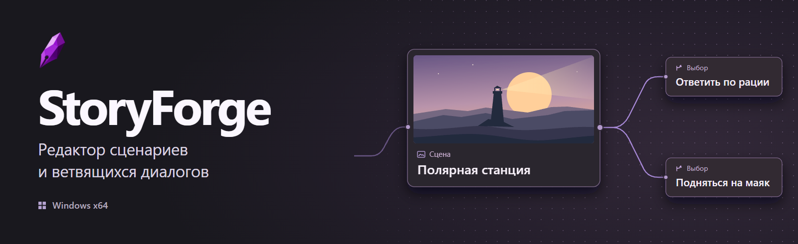
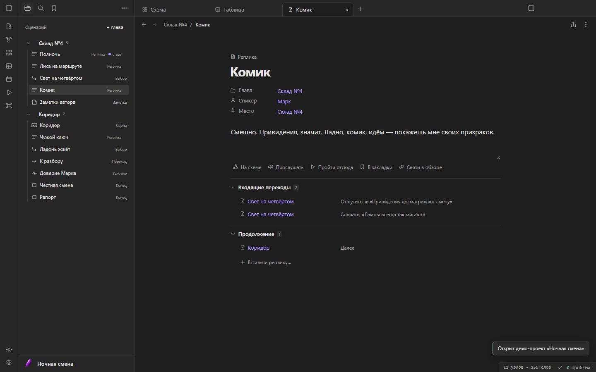
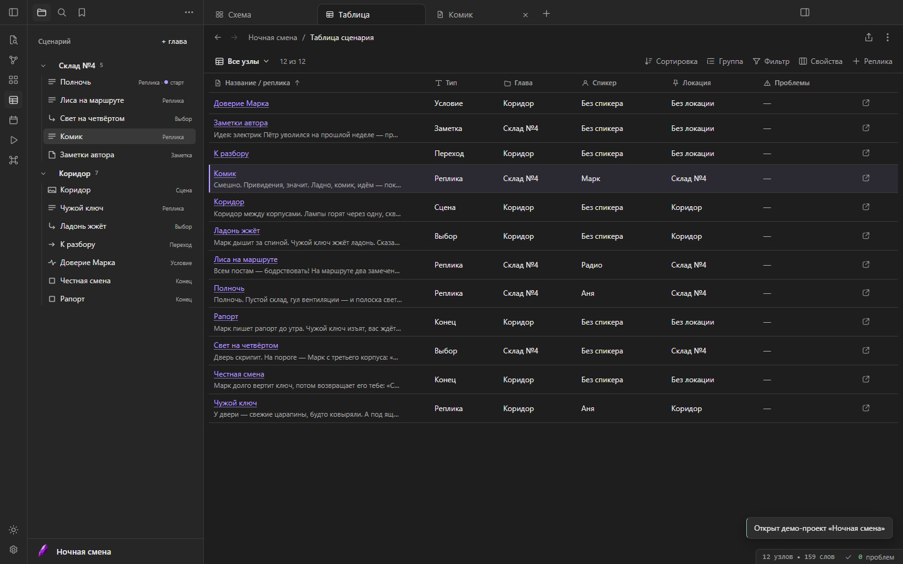
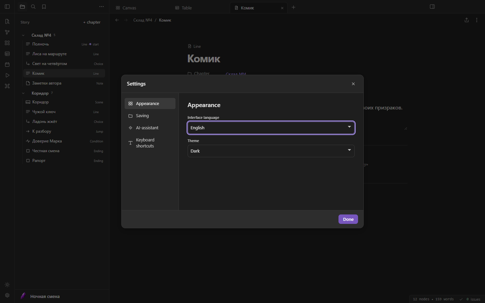

**Настольный редактор ветвящихся диалогов и игровых сценариев.** Напишите сцену, свяжите её с вариантами ответа и пройдите ветку с текущими значениями переменных. Сценарий, иллюстрации и настройки голосов хранятся в локальном проекте `.sfproj`.

[**Скачать для Windows x64**](https://github.com/sunakle/Story-Studio/releases/download/v1.2.0/StoryForge-Setup-1.2.0-x64.exe) · [English README](README.en.md) · [Руководство](docs/guide.ru.md) · [Все выпуски](https://github.com/sunakle/Story-Studio/releases)

[Схема переходов](docs/gallery/flow.png)

## Установка

1. Скачайте установщик из раздела [Releases](https://github.com/sunakle/Story-Studio/releases/latest) и запустите его. В сборку для Windows x64 входит Electron. Node.js нужен только для разработки.
2. Откройте **StoryForge** с рабочего стола. При первом запуске откроется новый проект. Нажмите **Ctrl+O**, чтобы открыть свой файл `.sfproj`.
3. В **Настройки → Оформление** выберите **Русский** или **English**. Язык интерфейса сохраняется между запусками. Тексты и названия сцен остаются на языке автора.

## От первой реплики до прохождения

| В редакторе | Что можно сделать |
| --- | --- |
| Сцена и схема | Писать реплики, назначать персонажей, соединять ответы и условия. Вернуться к соседней сцене можно по входящим и исходящим переходам. |
| Таблица и поиск | Найти серию реплик по главе, типу, персонажу или локации. Например, `type:line speaker:Анна` выбирает реплики Анны. |
| Прохождение | Начать с выбранной сцены, выбрать ответ, увидеть изменения переменных и вернуться на шаг назад. |
| Обзор сюжета | Посмотреть связи сцен, глав и персонажей. Наведение выделяет соседей, а после перетаскивания точка свободно движется под действием связей. |
| Студия голоса | Настроить тембр персонажа, послушать реплику, обработать сэмпл и экспортировать WAV. |
| Экспорт | Подготовить диалоги для Godot 4 или Ren’Py, получить Markdown или JSON. Для подключения AI-ассистента укажите свой OpenAI-совместимый сервис в настройках. |

## Из текста в ноды

Откройте вкладку **Сценарий** и напишите сцену обычным текстом. Укажите, где она происходит, кто говорит и что меняет выбор игрока. Текст сохраняется внутри проекта. Нажмите **Создать ноды…**, проверьте сообщение в чате и отправьте. Ассистент может также править выбранный фрагмент, продолжать существующие ветви и переиспользовать персонажей. **Ctrl+Z** отменяет правки одного запроса вместе.

В настройках AI укажите ключ и точный ID модели. По умолчанию выбран один DeepSeek. Для шлюза с несколькими моделями выберите свой сервер, введите его OpenAI-совместимый адрес и основную модель. Включите **Режим агентов** и перечислите **Модели-соавторы** по одной на строку. После вертикальной черты можно указать задачу, например «диалоги». Соавторы получают текст проекта и текущие вложения параллельно через одно подключение. Основная модель сверяет варианты и вносит итоговые правки. Черновик и статус каждого участника видны в чате.

Фото можно вставить из буфера, перетащить или прикрепить кнопкой в чате. Для официального API DeepSeek поддержка изображений есть у модели `deepseek-flash`. [Фото в API DeepSeek](https://api-docs.deepseek.com/guides/vision/)

В настройках AI можно раскрыть **Встроенные навыки сценариста**. Три встроенных навыка помогают писать диалоги, выстраивать сцены и редактировать черновик. Их источники и условия использования доступны в установленном приложении. [Исходная коллекция навыков](https://github.com/jwynia/agent-skills)


## Как сохранить голос

Выберите реплику и откройте студию голоса. В списке выберите персонажа для всех его реплик или **Выбранная реплика** для отдельного звучания. Настройте голос или загрузите WAV и сохраните проект сочетанием **Ctrl+S**. Файл `.sfproj` содержит настройки и аудио, поэтому его можно перенести на другой компьютер. Чтобы использовать тот же голос в других проектах на этом компьютере, откройте **Библиотека голосов**, введите имя и нажмите **Сохранить**.

## Галерея

| Сцена | Таблица сценария |
| --- | --- |
| [](docs/gallery/scene.png) | [](docs/gallery/table.png) |
| **Прохождение ветки** | **Студия голоса** |
| [](docs/gallery/playback.png) | [](docs/gallery/voice.png) |
| **Английский интерфейс** | **Закрытие с несохранёнными правками** |
| [](docs/gallery/english.png) | [](docs/ui-obsidian/09-close.png) |

### Граф в движении


На записи показано, как связанные узлы двигаются вслед за персонажем, когда вы тянете его мышью.

## Горячие клавиши

| Сочетание | Действие |
| --- | --- |
| `Ctrl+S` / `Ctrl+Shift+S` | Сохранить / сохранить как |
| `Ctrl+K` | Найти сцену или сущность |
| `Ctrl+Shift+G` | Открыть обзор связей |
| `Ctrl+Shift+O` | Открыть студию голоса |

## Запуск из исходников

Для разработки в Windows установите Git и Node.js 22 или новее с npm.

```powershell
git clone https://github.com/sunakle/Story-Studio.git
cd Story-Studio
npm.cmd ci
npm.cmd start
```

`npm.cmd test` проверяет модель, сохранение, воспроизведение и экспорт. `npm.cmd run selftest` запускает приёмочные сценарии в отдельном профиле Electron. Для сборки установщика выполните `npm.cmd run dist:win` из Windows с установленным Inno Setup 6.3+.

[Формат проекта и внутренние интерфейсы](CONTRACT.md) · [Инструменты и проверки](tools/README.md) · [Лицензия MIT](LICENSE)

